<!-- Profile README for Karam Kottish. Panels live in /assets and are generated, light and dark. -->

<picture><source media="(prefers-color-scheme: dark)" srcset="https://raw.githubusercontent.com/Karamkottish/Karamkottish/main/assets/masthead-dark.svg"></picture>

 

I'm a full-stack engineer at Sama Tech, working mostly in Next.js, NestJS and Prisma. I also run [Kol Shei](https://kol-shei.com), my own company. It sells genuine parts for Chinese cars, shipped from China to Damascus, and I built the backend, the website and both mobile apps myself, then took it to production.

Before that I was a product manager at Paws Pal Connect, running five teams at once, so I tend to ask what a feature is for before I ask how to build it. I finish my Informatics Engineering degree in early 2027.

**Hiring?** Write to [karamkottish@gmail.com](mailto:karamkottish@gmail.com). I can start right away, remote or on-site in the Gulf.

 

<picture><source media="(prefers-color-scheme: dark)" srcset="https://raw.githubusercontent.com/Karamkottish/Karamkottish/main/assets/h-01-dark.svg">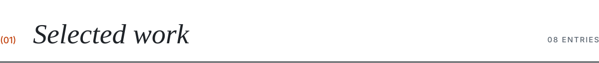</picture>

<a href="https://kol-shei.com"><picture><source media="(prefers-color-scheme: dark)" srcset="https://raw.githubusercontent.com/Karamkottish/Karamkottish/main/assets/work-01-dark.svg">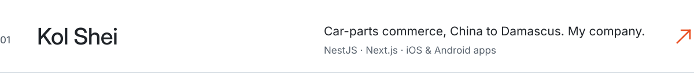</picture></a>
<picture><source media="(prefers-color-scheme: dark)" srcset="https://raw.githubusercontent.com/Karamkottish/Karamkottish/main/assets/work-02-dark.svg">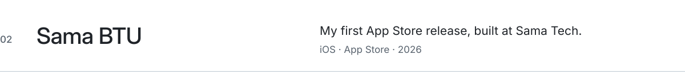</picture>
<a href="https://github.com/Karamkottish/Solarsystem3D"><picture><source media="(prefers-color-scheme: dark)" srcset="https://raw.githubusercontent.com/Karamkottish/Karamkottish/main/assets/work-03-dark.svg">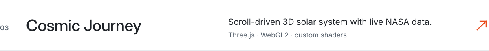</picture></a>
<a href="https://github.com/Karamkottish/GamingFullstack"><picture><source media="(prefers-color-scheme: dark)" srcset="https://raw.githubusercontent.com/Karamkottish/Karamkottish/main/assets/work-04-dark.svg">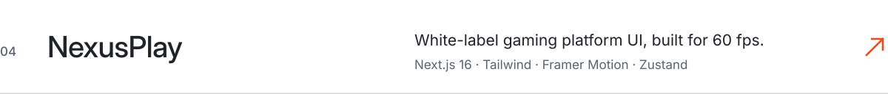</picture></a>
<a href="https://github.com/Karamkottish/RK-SWEETHOUSE"><picture><source media="(prefers-color-scheme: dark)" srcset="https://raw.githubusercontent.com/Karamkottish/Karamkottish/main/assets/work-05-dark.svg">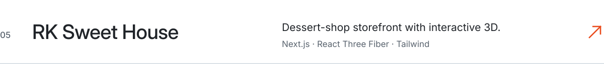</picture></a>
<a href="https://github.com/Karamkottish/MyUniversity"><picture><source media="(prefers-color-scheme: dark)" srcset="https://raw.githubusercontent.com/Karamkottish/Karamkottish/main/assets/work-06-dark.svg">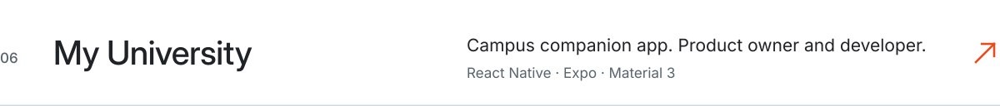</picture></a>
<a href="https://github.com/Karamkottish/BustaniPlus"><picture><source media="(prefers-color-scheme: dark)" srcset="https://raw.githubusercontent.com/Karamkottish/Karamkottish/main/assets/work-07-dark.svg">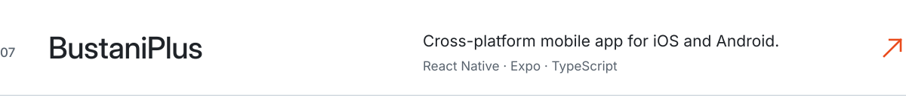</picture></a>
<picture><source media="(prefers-color-scheme: dark)" srcset="https://raw.githubusercontent.com/Karamkottish/Karamkottish/main/assets/work-08-dark.svg">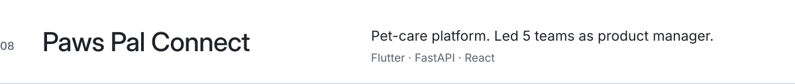</picture>

Also on the bench: <b>Revonix</b>, my graduation project (an artisan marketplace in Flutter), and <b>Chatly</b>, a secure chat platform where I led security.

  

<picture><source media="(prefers-color-scheme: dark)" srcset="https://raw.githubusercontent.com/Karamkottish/Karamkottish/main/assets/h-02-dark.svg"></picture>

<picture><source media="(prefers-color-scheme: dark)" srcset="https://raw.githubusercontent.com/Karamkottish/Karamkottish/main/assets/record-dark.svg">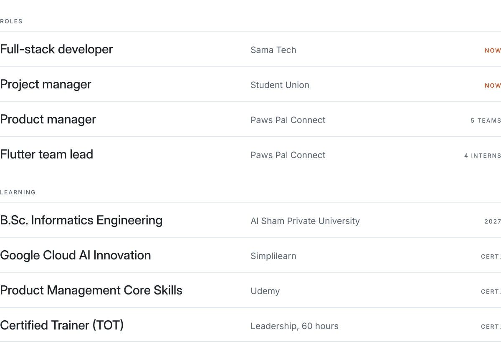</picture>

 

<picture><source media="(prefers-color-scheme: dark)" srcset="https://raw.githubusercontent.com/Karamkottish/Karamkottish/main/assets/h-03-dark.svg">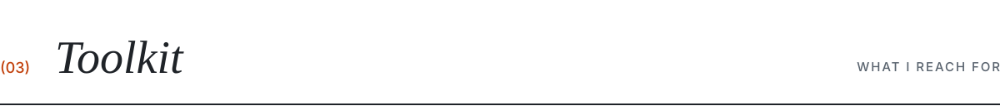</picture>

<picture><source media="(prefers-color-scheme: dark)" srcset="https://raw.githubusercontent.com/Karamkottish/Karamkottish/main/assets/toolkit-dark.svg">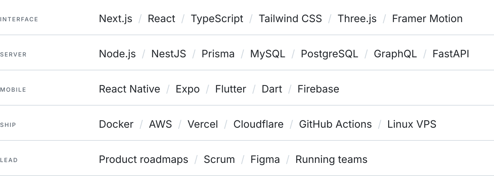</picture>

 

<picture><source media="(prefers-color-scheme: dark)" srcset="https://raw.githubusercontent.com/Karamkottish/Karamkottish/main/assets/h-04-dark.svg"></picture>

<a href="mailto:karamkottish@gmail.com"><picture><source media="(prefers-color-scheme: dark)" srcset="https://raw.githubusercontent.com/Karamkottish/Karamkottish/main/assets/contact-email-dark.svg">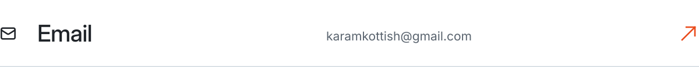</picture></a>
<a href="https://www.linkedin.com/in/karam-kottish/"><picture><source media="(prefers-color-scheme: dark)" srcset="https://raw.githubusercontent.com/Karamkottish/Karamkottish/main/assets/contact-linkedin-dark.svg">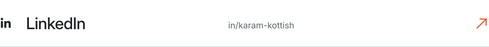</picture></a>
<a href="https://gitlab.com/KaramKottish01"><picture><source media="(prefers-color-scheme: dark)" srcset="https://raw.githubusercontent.com/Karamkottish/Karamkottish/main/assets/contact-gitlab-dark.svg">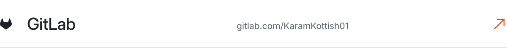</picture></a>
<a href="https://www.instagram.com/eng.karamkottish/"><picture><source media="(prefers-color-scheme: dark)" srcset="https://raw.githubusercontent.com/Karamkottish/Karamkottish/main/assets/contact-instagram-dark.svg">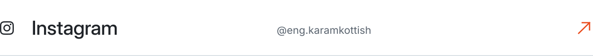</picture></a>
<a href="https://karamkottish.github.io/Karam_Portiofolio/"><picture><source media="(prefers-color-scheme: dark)" srcset="https://raw.githubusercontent.com/Karamkottish/Karamkottish/main/assets/contact-portfolio-dark.svg">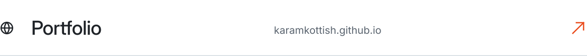</picture></a>

<picture><source media="(prefers-color-scheme: dark)" srcset="https://raw.githubusercontent.com/Karamkottish/Karamkottish/main/assets/footer-dark.svg">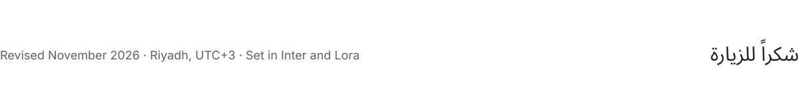</picture>
